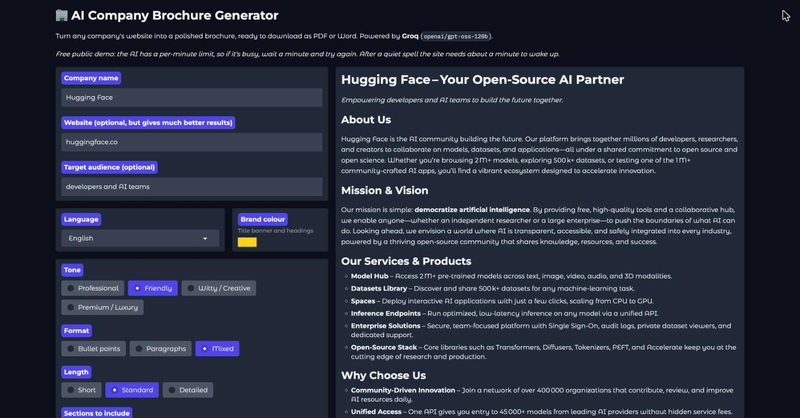
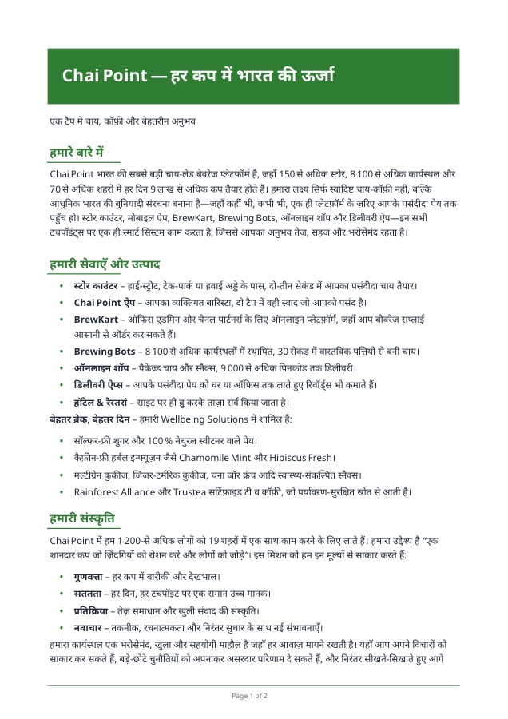

# 🏢 AI Company Brochure Generator

[](https://github.com/C0derANANT/ai-engineering-projects/actions/workflows/brochure-tests.yml)

Turn any company's website into a polished, ready-to-share brochure in seconds.
The app reads the company's website, uses an LLM to write the brochure in the
language, tone and sections you choose, shows a live preview, and exports it as
a styled **PDF** and **Word (DOCX)** file in your brand colour.

**🌐 Live demo: [ai-brochure-generator-af0t.onrender.com](https://ai-brochure-generator-af0t.onrender.com)**
(free hosting, kept awake by a [GitHub Action](../.github/workflows/keep-awake.yml) that visits it every 10 minutes, so it normally opens straight away)

Built as part of the Incapp AI Engineer course.



<details>
<summary>Sample output: a Hindi brochure PDF generated on the live site</summary>



</details>

## ✨ Features

- **Website-aware:** scrapes the homepage plus the About, Services and Contact/Careers pages for real facts, including emails and phone numbers for "Get in Touch"
- **Company logo:** finds the site's logo (its app icon, a large favicon, or a square social-share image) and puts it on the PDF title banner and at the top of the Word file. Logos get the same safety checks as pages (no private network addresses, max 1 MB, must be a real image of at least 64 px); with no usable logo the banner simply has none
- **11 languages:** English, Hindi, Marathi, Spanish, French, German, Portuguese, Italian, Japanese, Chinese and Korean, with headings translated too
- **Pick your sections:** About Us, Mission & Vision, Services & Products, Technologies, Why Choose Us, Culture, FAQ, Get in Touch
- **Brand colour:** recolours the PDF title banner, headings and bullets and the Word headings. Light colours stay readable because text colours are adjusted automatically. Changing the colour after generating re-exports the files instantly, with no new AI call
- **Customisable style:** tone (Professional, Friendly, Witty, Luxury), format (bullets / paragraphs / mixed), length and target audience
- **One-click examples:** five ready-made setups (e.g. Chai Point in Hindi, Stripe in Spanish with an FAQ)
- **Live streaming preview:** watch the brochure being written
- **Edit before you download:** the **Edit** tab holds the brochure's text, so you can fix a sentence or fill in a missing detail, then press **Update PDF & DOCX** (no new AI call)
- **No made-up facts:** the prompt forbids inventing contact details, numbers or clients. A missing detail becomes a `[Phone]`-style placeholder that the app lists for you to fill in, and any placeholder you leave is kept out of the PDF and DOCX (a line like `[Phone] – [Address]` is dropped, and so is a heading with nothing real left under it)
- **Styled exports:** PDF with a title banner, section headings, real bullets and page numbers; DOCX with proper Word headings and lists
- **Clickable links:** websites, emails and phone links open with one click in both the PDF and the Word file, including plain addresses like `huggingface.co` or `press@acme.com` in the text. Only web, email and phone links are made clickable, so an AI-written `javascript:` link stays plain text
- **Clear errors:** plain-English messages for a wrong API key, rate limits, unknown models, blocked or JavaScript-only websites
- **Multiple LLM providers:** Groq by default, Gemini as a fallback (both via the OpenAI-compatible API)
- **Tested:** pytest tests for URL checks, the private-network block, page and link picking, logos, links, placeholders, the AI prompt and the PDF/DOCX exports, run by GitHub Actions on every push

## 🧰 Tech Stack

| Purpose        | Library                         |
| -------------- | ------------------------------- |
| Web UI         | Gradio                          |
| LLM client     | OpenAI SDK → Groq / Gemini      |
| Web scraping   | Requests + BeautifulSoup        |
| Logo images    | Pillow                          |
| PDF export     | fpdf2 + uharfbuzz (text shaping for Hindi and other complex scripts) |
| Word export    | python-docx                     |
| Config         | python-dotenv                   |
| Tests and CI   | pytest + GitHub Actions         |

## 📁 Project Structure

```
01-Brochure-Generator/
├── app.py                    # Gradio web app (entry point)
├── Brochure-Generator.ipynb  # Notebook: use the package or launch the app from Jupyter
├── brochure/
│   ├── config.py             # API keys, model and paths
│   ├── scraper.py            # Website scraping + logo finder
│   ├── generator.py          # Prompt building + LLM streaming
│   └── exporters.py          # Markdown → PDF / DOCX, brand colours, fonts
├── tests/                    # pytest tests (no internet or API key needed)
├── Dockerfile                # Container for the public demo (with Hindi + CJK fonts)
├── docs/                     # README screenshots
├── outputs/                  # Generated brochures (git-ignored)
├── legacy/                   # Original v1 notebook
├── requirements.txt
├── requirements-dev.txt      # requirements.txt + pytest
├── pytest.ini
└── .env.example
```

GitHub Actions workflows live at the repo root in [`.github/workflows/`](../.github/workflows):
`brochure-tests.yml` runs the tests on every push and `keep-awake.yml` keeps the demo awake.

## 🚀 Getting Started

```bash
# 1. Install dependencies
pip install -r requirements.txt

# 2. Add your API key
cp .env.example .env     # then paste your GROQ_API_KEY

# 3. Run
python app.py            # opens in your browser
```

Options:

```bash
python app.py --share        # also print a temporary public link (72 h)
python app.py --no-browser   # don't open a browser tab
python app.py --port 7860    # fixed port
```

> A `.env` in any parent folder also works, since the app searches upward for it.
> Your key stays in `.env`, which git ignores. A `--share` link doesn't reveal the key,
> but anyone with the link uses your quota, so only share it with people you trust.

## 🧪 Tests

```bash
pip install -r requirements-dev.txt
pytest
```

The tests never touch the internet or need an API key (DNS lookups are faked), so they run
anywhere in a few seconds. GitHub Actions runs the same command on every push.

## ☁️ Deploy Your Own Copy (Render, free)

[](https://render.com/deploy?repo=https://github.com/C0derANANT/ai-engineering-projects)

This gives you a free public URL where visitors don't need a key or any setup.

1. Fork this repo, sign in to [Render](https://render.com) with GitHub (no card needed).
2. **New → Blueprint**, pick your fork. Render reads [`render.yaml`](../render.yaml) and builds the
   [`Dockerfile`](Dockerfile).
3. When asked for `GROQ_API_KEY`, paste your Groq key. Render keeps it on its servers:
   it is never in the code and visitors can't see it.

Every push to `main` redeploys automatically. Free plan notes: the site sleeps after
15 minutes without visitors and then takes 30-60 seconds to wake. The
[`keep-awake`](../.github/workflows/keep-awake.yml) workflow stops that by visiting it every
10 minutes (change `DEMO_URL` in it to your own Render URL). Running all month uses about
744 of Render's 750 free hours, so keep it to one always-on free service. On Groq's free plan
the worst case is hitting the rate limit (the app tells visitors to wait a minute), with no bill.
The Docker image contains only the app's own files, never `.env` or `outputs/`.

## ⚙️ Configuration

| Variable             | Required | Default                    |
| -------------------- | -------- | -------------------------- |
| `GROQ_API_KEY`       | Yes*     | none                       |
| `GROQ_MODEL`         | No       | `openai/gpt-oss-120b`      |
| `GOOGLE_API_KEY`     | Yes*     | none (used if no Groq key) |
| `GEMINI_MODEL`       | No       | `gemini-3.6-flash`         |
| `ALLOW_PRIVATE_URLS` | No       | off. Set to `1` to let the scraper read `localhost` / home-network sites (blocked by default because the app can be shared publicly) |

\* At least one of the two keys is required.

**Fonts for non-English PDFs:** on macOS every listed language works out of the box.
On Windows the app uses the built-in Nirmala UI, Microsoft YaHei, Yu Gothic and Malgun Gothic fonts.
On Linux, install `fonts-noto-core` and `fonts-noto-cjk` (the Dockerfile already does).
The Word file never needs extra fonts.

## 📝 Changelog

**v4:** nicer files and a faster demo
- Websites, emails and phone links are clickable in the PDF and DOCX
- An **Edit** tab to fix the text or fill in missing details before downloading; unfilled `[Phone]`-style placeholders are kept out of the files
- The company's logo on the PDF title banner and at the top of the Word file
- A scheduled GitHub Action keeps the free Render demo awake, so visitors no longer wait a minute for it to start
- pytest tests and a GitHub Actions workflow that runs them on every push

**v3:** bug fixes and new options
- New: output language, section picker, brand colour picker, richer examples
- Free public hosting on Render (`Dockerfile` + `render.yaml`); the public link is now opt-in with `--share`
- Hindi, Chinese, Japanese and Korean text no longer disappears from the PDF; Arabic letters join correctly
- Huge pages no longer freeze the app (downloads capped at 2 MB / 25 s; a 48 MB page went from 69 s and 1.7 GB of RAM to under 3 s)
- The scraper refuses private network addresses, skips non-HTML links (PDFs, images), keeps contact details, and prefers the About page
- A dropped connection or a cut-off reply is reported instead of being exported as a finished brochure
- `<think>` reasoning, "Here is your brochure" intros and code fences are stripped from model output
- No more literal `**` in PDF headings; `_italic_`, `__bold__`, escapes and `&amp;` are handled
- Word numbered lists restart at 1; file names are unique even for same-second runs and very long company names
- The API key is checked before scraping, and blank values in `.env` no longer override keys set in the shell

**v2:** refactored the notebook into a modular app:
- Fixed PDF exports where every hyphen and bullet showed up as `?`
- Real formatting (bold, headings, bullet lists) in both PDF and DOCX
- Unique timestamped filenames instead of overwriting `brochure.pdf`
- Scrapes key sub-pages, accepts URLs without `https://`, warns on unreadable sites
- Public share link (`share=True`) printed on every run
- Streaming preview, tone/format/length options, input validation
