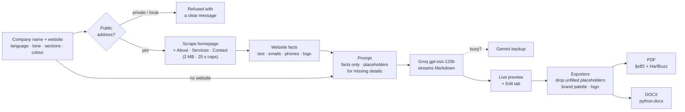

# 🏢 AI Company Brochure Generator

[](https://github.com/C0derANANT/ai-engineering-projects/actions/workflows/brochure-tests.yml)

Turn any company's website into a polished, ready-to-share brochure in seconds. The app reads the website, has an LLM write the brochure in the language, tone and sections you pick, streams a live preview you can edit, and exports a styled **PDF** and **Word (DOCX)** file in your brand colour. Built for the Incapp AI Engineer course.

**Live demo: [ai-brochure-generator-af0t.onrender.com](https://ai-brochure-generator-af0t.onrender.com)** (free plan: the first visit after a quiet spell takes about a minute to wake up).


<details>
<summary>Sample output: a Hindi brochure PDF generated on the live site</summary>


</details>

| What it does | How |
|---|---|
| Writes from **real facts** on the company's site | Scrapes the homepage plus the best About, Services and Contact/Careers pages, including emails and phone numbers |
| **Never makes up** contact details or numbers | The prompt forbids it; a missing detail becomes a `[Phone]`-style placeholder you fill in or that's left out of the files |
| Speaks **11 languages** | English, Hindi, Marathi, Spanish, French, German, Portuguese, Italian, Japanese, Chinese and Korean, headings included |
| Exports print-ready **PDF and DOCX** | fpdf2 with HarfBuzz text shaping (so Hindi renders correctly), python-docx with real Word headings and lists |
| Uses **your brand colour and logo** | Builds a readable palette from one colour (WCAG contrast), finds the site's logo and puts it on the title banner |
| Lets you **edit before downloading** | An Edit tab with the Markdown; one click re-exports, with no new AI call |
| Stays up when the AI is busy | Groq first; if it's rate-limited or down before writing anything, Gemini takes over automatically |
| Is **safe to share publicly** | Refuses private-network addresses at every redirect, caps page size and time, only makes web, email and phone links clickable |

## How it works



## Project layout

```
01-Brochure-Generator/
├── app.py                    # Gradio web app (entry point)
├── brochure/
│   ├── config.py             # API keys, models, paths, hosted mode
│   ├── scraper.py            # safe website scraping, contact details, logo finder
│   ├── generator.py          # prompt, streaming, Groq → Gemini fallback, friendly errors
│   └── exporters.py          # Markdown → PDF / DOCX, links, placeholders, brand colours, fonts
├── tests/                    # 97 tests, no internet or API key needed
├── Brochure-Generator.ipynb  # use the package or launch the app from Jupyter
├── Dockerfile                # the Render image (with Hindi + CJK fonts)
├── docs/                     # README screenshots
├── legacy/                   # the original v1 notebook from class
└── outputs/                  # generated brochures (git-ignored)
```

## Run it locally

Needs Python 3.12 or newer.

```bash
cd 01-Brochure-Generator
python3 -m venv .venv && source .venv/bin/activate
pip install -r requirements.txt
cp .env.example .env          # then add GROQ_API_KEY (and optionally GOOGLE_API_KEY)
python app.py                 # opens in your browser
```

Get a free Groq key at [console.groq.com/keys](https://console.groq.com/keys).

```bash
python app.py --share        # also print a temporary public link (72 h)
python app.py --no-browser   # don't open a browser tab
python app.py --port 7860    # fixed port
```

A `.env` in any parent folder also works, since the app searches upward for it. Anyone with a `--share` link uses your API quota, so only share it with people you trust.

## Try these

Click an example in the app, then **Generate**:

- **Hugging Face · friendly · yellow:** logo on the banner, real press email, `[Phone]` left for you to fill in
- **Chai Point · in Hindi:** Devanagari text shaped correctly in the PDF
- **Stripe · detailed, in Spanish + FAQ:** translated headings and an FAQ section
- **Groq · short bullet points:** a one-page brochure
- **Blue Tokai · no website:** general copy with no invented numbers, clients or dates

## Edge cases handled

| Situation | What happens |
|---|---|
| Website hides emails behind Cloudflare ("[email protected]") | The encoded address is decoded, so the real email reaches the brochure |
| Address points to `localhost`, a home router or a private IP (also after a redirect) | Refused before any request is made |
| Huge or slow pages | Only the first 2 MB is read; the whole site gets 25 seconds (a 48 MB page went from 69 s and 1.7 GB of RAM to under 3 s) |
| JavaScript-only or blocked site | A warning says the brochure will be mostly generic; blocked sites get the HTTP reason |
| Links to PDFs, images or other sites | Skipped when picking pages to read |
| Logo that is huge, tiny, not square or a "decompression bomb" | Rejected (max 1 MB, at least 64 px, pixel cap); the banner simply has no logo |
| Missing phone, email or address | A placeholder appears in the preview; unfilled ones are dropped from the files, and so is a heading left empty |
| AI writes a `javascript:` or `file:` link | Stays plain text; only web, email and phone links become clickable |
| Groq rate-limited, down or timing out | Gemini writes the brochure instead (when a Gemini key is set) and the app says so |
| Wrong API key | Reported clearly, never hidden by the fallback |
| Connection drops or the reply is cut off | Reported instead of exported as a finished brochure |
| Model adds `<think>` reasoning, "Here is your brochure" or code fences | Stripped from the output |
| Typographic spaces the font can't draw (e.g. `₹ 100` with a narrow space) | Swapped for normal spaces so nothing vanishes from the PDF |
| `₹`, Hindi, Chinese, Japanese or Korean text | Fallback fonts load only when needed; Arabic letters join correctly |
| Light brand colour like yellow | Text colours are darkened until they pass WCAG contrast |
| Two brochures made in the same second | Random suffix in the file name, so nothing is overwritten |

## Tests and continuous integration

```bash
pip install -r requirements-dev.txt
pytest
```

The 97 tests never touch the internet or need an API key (DNS lookups and the LLM client are faked), so they run anywhere in a few seconds. They cover URL checks, the private-network block, page, link and logo picking, Cloudflare email decoding, placeholders, the prompt, streaming and the Gemini fallback, and the PDF and DOCX exports. GitHub Actions runs them on every push that touches this folder ([`brochure-tests.yml`](../.github/workflows/brochure-tests.yml)).

## Deploy (Render)

The live demo runs on Render's free plan from the [`render.yaml`](../render.yaml) Blueprint at the repo root (service `ai-brochure-generator`, Docker, built from this folder's [`Dockerfile`](Dockerfile), which also installs Hindi and CJK fonts).

- **Only tested code goes live:** Render deploys a push only after the GitHub Actions tests pass (`autoDeployTrigger: checksPass`).
- **Keys stay out of the repo:** `GROQ_API_KEY` (and optionally `GOOGLE_API_KEY` for the fallback) are set in the Render dashboard.
- **Free-plan limits:** the service sleeps after 15 idle minutes and takes about a minute to wake. It shares the workspace's 750 free hours a month with the other demos in this repo.
- **Nothing private in the image:** the Docker image copies only the app's own files, never `.env` or `outputs/`.

To host your own copy: fork the repo, sign in to [Render](https://render.com) with GitHub, choose **New → Blueprint**, pick your fork and paste your Groq key when asked.

## Configuration

| Variable | Required | Default |
|---|---|---|
| `GROQ_API_KEY` | Yes* | none |
| `GROQ_MODEL` | No | `openai/gpt-oss-120b` |
| `GOOGLE_API_KEY` | Yes* | none (backup when Groq is busy, or the main provider without a Groq key) |
| `GEMINI_MODEL` | No | `gemini-3.6-flash` |
| `ALLOW_PRIVATE_URLS` | No | off. Set to `1` to let the scraper read `localhost` or home-network sites while testing |

\* At least one of the two keys is required.

**Fonts for non-English PDFs:** macOS works out of the box. Windows uses Nirmala UI, Microsoft YaHei, Yu Gothic and Malgun Gothic. On Linux, install `fonts-noto-core` and `fonts-noto-cjk` (the Dockerfile already does). The Word file never needs extra fonts.

## Stack

Gradio 6 · OpenAI SDK → Groq (`gpt-oss-120b`) and Gemini · Requests + BeautifulSoup · Pillow · fpdf2 + uharfbuzz · python-docx · pytest + GitHub Actions · Docker on Render

## Changelog

**v5:** bug fixes found by testing on live websites
- Emails hidden by Cloudflare's email protection are decoded (they used to arrive as "[email protected]" and were dropped from the files)
- Narrow and thin spaces no longer vanish from the PDF
- Groq → Gemini fallback when Groq is busy or down, instead of an error
- Removed the keep-awake workflow: GitHub ran it about 3 times a day instead of every 10 minutes, so it never kept the demo awake

**v4:** clickable links in the PDF and DOCX, an Edit tab with placeholder handling, the company logo on the title banner, pytest tests and GitHub Actions

**v3:** output language, section picker and brand colour; Render hosting; Hindi, CJK and Arabic text in the PDF; 2 MB / 25 s scraping caps; private-network block; cleaner model output; unique file names

**v2:** refactored the class notebook into a modular app with formatted PDF and DOCX exports, sub-page scraping and a streaming preview

---

Built by **Anant Aggarwal** · B.Tech CSE (AI)
