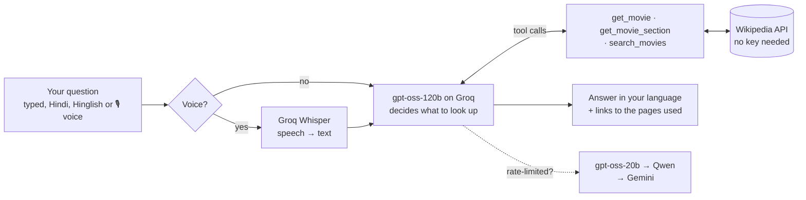

# 🎬 AI Movie: a movie chatbot that checks its facts

[](https://github.com/C0derANANT/ai-engineering-projects/actions/workflows/movie-tests.yml)

Ask anything about any movie (director, cast and characters, production house, budget, box office, release date, plot, hit or flop) in **English, हिंदी or Hinglish**, typed or spoken. Instead of answering from memory, the LLM looks the film up on **Wikipedia** with tool calls, answers from those facts, and links the pages it used. Built for the Incapp AI Engineer course, starting from the class chatbot in `AI-Movie-Chatbot.ipynb`.

**Live demo: [ai-movie-chatbot-j2i4.onrender.com](https://ai-movie-chatbot-j2i4.onrender.com)** (free plan: the first visit after a quiet spell takes about a minute to wake up).

| What it does | How |
|---|---|
| Gets budgets, box office and release dates **right** | The LLM calls tools that read Wikipedia's infobox and sections, so numbers come from the article, not the model's memory |
| Shows **where every answer came from** | Links to the Wikipedia pages (and sections) it read appear under each answer |
| Knows **who played whom** | Each lookup includes the top of the film's Cast section ("Prabhas as Amarendra Baahubali") |
| Reads the **plot, box-office run, reviews and awards** | A second tool reads one section of the page: Plot, Box office, Critical response, Accolades … |
| Handles **unclear titles** | "Pathaan" finds *Pathaan (film)*; "Don 2006" picks the 2006 film; a search tool finds films from a description |
| Speaks English, हिंदी and Hinglish | Replies in the user's language and script (Devanagari for Hindi, English letters for Hinglish) |
| Takes **voice questions** | Groq Whisper (`whisper-large-v3-turbo`) transcribes the mic recording |
| Stays up on a free API plan | gpt-oss-120b first, then gpt-oss-20b and Qwen on Groq (each has its own rate limit), then Gemini |

## Level 0 → level 2

| | Class version (`AI-Movie-Chatbot.ipynb`) | Now |
|---|---|---|
| Facts | The model's memory, so budgets and dates can be invented | Looked up on Wikipedia for every film question |
| Sources | None | Links to the pages and sections used |
| When the AI is busy | Error message (or a raw API error) | Three more models take over automatically |
| Input | Typed English or Hinglish | Typed or spoken; English, Hindi, Hinglish |
| Long chats | The whole history is sent every time | The last 3 exchanges, trimmed |
| Tests | None | 73 tests, run by GitHub Actions on every push |
| Hosting | A temporary `gradio.live` link | A Docker image on Render |

## How it works



**The tools:**

| Tool | Returns |
|---|---|
| `get_movie(title, year?)` | Infobox facts (director, writers, cast, music, studio, release date, runtime, budget, box office), the article's summary, the main cast with their characters, and other films with similar titles |
| `get_movie_section(title, section)` | One section's text: Plot, Cast, Box office, Critical response, Accolades … (matched loosely, so "story" finds Plot and "collection" finds Box office) |
| `search_movies(query)` | Film articles matching words like "Rajamouli films" or "Nolan dream heist" |

## Project layout

```
02-AI-Movie-Chatbot/
├── app.py                  # Gradio app (chat, mic, examples)
├── movie/
│   ├── config.py           # settings, .env handling, Render port
│   ├── wikipedia.py        # film search, infobox and section parsing, caching
│   ├── tools.py            # the lookups described for the LLM's tool calling
│   ├── assistant.py        # tool-calling loop, streaming, fallbacks, history, language
│   └── voice.py            # Whisper transcription and silence detection
├── tests/                  # 73 tests: fake Wikipedia, fake LLM, fake Whisper
├── AI-Movie-Chatbot.ipynb  # the original class version, kept for comparison
└── Dockerfile              # the Render image
```

## Run it locally

Needs Python 3.12 or newer.

```bash
cd 02-AI-Movie-Chatbot
python3 -m venv .venv && source .venv/bin/activate
pip install -r requirements.txt
cp .env.example .env          # then add GROQ_API_KEY (and optionally GOOGLE_API_KEY)
python app.py                 # opens http://localhost:7860
```

Get a free Groq key at [console.groq.com/keys](https://console.groq.com/keys). Without a key the app still opens and explains what's missing; adding one to `.env` turns answers on without a restart.

## Try these

- `Tell me everything about the movie Inception`: a Movie Card with budget, box office and verdict
- `Pathaan ka budget aur box office collection kitna tha?`: Hinglish in, Hinglish out, ₹250 crore and ₹1,050.30 crore
- `बाहुबली 2 में मुख्य किरदार किसने निभाए?`: Hindi, with the characters from Wikipedia's cast list
- `Compare Jawan and Pathaan: budget, box office and verdict`: two lookups, one table
- `What is the plot of Sholay, without spoilers?`: reads the Plot section
- `Don 2006 ka director kaun tha?`: picks the right film among several called *Don*
- `What's the capital of France?`: politely declined, since it isn't about movies

## Edge cases handled

| Situation | What happens |
|---|---|
| Title is also a person, place or disambiguation page ("Pathaan", "Don") | Falls back to a film-only search and says which film it used |
| Several films share a name | A year in the question picks the right one; other matches are passed to the model |
| A detail isn't on Wikipedia | The answer says so instead of guessing |
| Section asked for doesn't exist | Loose matching ("story" → Plot); if still missing, the model gets the list of real sections |
| Wikipedia is slow or down | A friendly message instead of a crash; successful lookups are cached |
| Groq's per-minute token limit (8,000 on the free tier) | The next Groq model takes over, then Gemini; each has its own limit |
| Wrong API key | Reported clearly, never hidden by the fallback |
| The model calls an unknown tool or sends broken arguments | An error goes back to the model, which then answers normally |
| Endless tool calls | Stops after 5 rounds and answers with what it has |
| Gemini rejects tool history without a "thought signature" | Google's documented placeholder signature is added |
| Silent or noise-only recording | Whisper's stock phrases ("Thank you", "Thanks for watching") are rejected with a clear message |
| Image or other non-audio upload | Explained; nothing crashes |
| Very long messages or chats | Questions over 1,000 characters are refused; history is cut to the last 3 exchanges |
| Off-topic questions | Politely declined |

## Tests and continuous integration

```bash
pip install -r requirements-dev.txt
pytest
```

The 73 tests fake Wikipedia (a made-up film called *Rocket Raja*), the LLM and Whisper, so they run offline in a few seconds with no keys. They cover infobox and section parsing, title fallbacks, the tool-calling loop, streaming tool arguments, every fallback path, history cleanup, languages, voice and the app wiring. GitHub Actions runs them on every push that touches this folder ([`movie-tests.yml`](../.github/workflows/movie-tests.yml)).

## Deploy (Render)

The [live demo](https://ai-movie-chatbot-j2i4.onrender.com) runs on Render's free plan from the [`render.yaml`](../render.yaml) Blueprint at the repo root (service `ai-movie-chatbot`, Docker, built from this folder's [`Dockerfile`](Dockerfile)).

- **Only tested code goes live:** Render deploys a push only after the GitHub Actions tests pass (`autoDeployTrigger: checksPass`).
- **Keys stay out of the repo:** `GROQ_API_KEY` (and optionally `GOOGLE_API_KEY`) are set in the Render dashboard.
- **Free-plan limits:** the service sleeps after 15 idle minutes and takes about a minute to wake. It shares the workspace's 750 free hours a month with the other demos in this repo.

To run the same image locally: `docker build -t ai-movie . && docker run -p 7860:7860 --env-file .env ai-movie`.

## Configuration

| Variable | Required | Default |
|---|---|---|
| `GROQ_API_KEY` | Yes* | none |
| `GOOGLE_API_KEY` | No* | none (Gemini backup) |
| `GROQ_MODEL` | No | `openai/gpt-oss-120b` |
| `GROQ_BACKUP_MODELS` | No | `openai/gpt-oss-20b,qwen/qwen3.8-27b` |
| `GEMINI_MODEL` | No | `gemini-3.6-flash` |

\* At least one of the two keys is required; voice questions need the Groq key.

## Stack

Gradio 6 · OpenAI SDK → Groq (`gpt-oss-120b`, `gpt-oss-20b`, Qwen, Whisper) and Gemini · Wikipedia API · Requests + BeautifulSoup · pytest + GitHub Actions · Docker on Render

---

Built by **Anant Aggarwal** · B.Tech CSE (AI) · Film facts come from [Wikipedia](https://en.wikipedia.org) (CC BY-SA).
