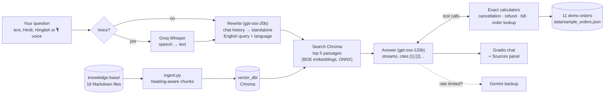

# 🍛 Crave Assist: RAG help assistant for CraveCart

A RAG (Retrieval-Augmented Generation) support assistant for **CraveCart**, a fictional Zomato-style food delivery company. Built for the Incapp AI Engineer project, starting from the class `RAG_APP.ipynb` and adding the upgrades below.

**Live demo: [crave-assist.onrender.com](https://crave-assist.onrender.com)** (free plan: the first visit after a quiet spell takes about a minute to wake up).


| What it does | How |
|---|---|
| Answers from 18 policy, FAQ and HR documents | Chroma vector DB built from heading-aware chunks (BGE embeddings on ONNX) |
| Cites the exact section behind every answer | `[n]` markers in the answer, plus a Sources panel with the matching passages |
| Gets refund and cancellation **maths exactly right** | The LLM calls Python tools on 11 demo orders (`#1042`–`#1052`) instead of doing money maths itself |
| Understands follow-up questions | Each question plus the chat history is rewritten into one standalone search query |
| Speaks English, हिंदी and Hinglish | Replies in the language and script the user typed in |
| Takes voice questions | Groq Whisper (`whisper-large-v3-turbo`) transcribes the mic recording |
| Stays up when the AI service is busy | Groq first; a Gemini backup takes over automatically on rate limits |

## How it works



## Project layout

```
03-Food-Delivery-RAG/
├── app.py                  # Gradio app (chat, Sources panel, demo orders, voice)
├── ingest.py               # builds the vector DB (python ingest.py --help)
├── rag/
│   ├── config.py           # settings, .env handling
│   ├── knowledge_base.py   # loading, heading-aware chunking, Chroma, auto-refresh
│   ├── assistant.py        # rewrite → search → answer, streaming, citations, history
│   ├── calculators.py      # exact fee, cancellation and refund maths (Decimal)
│   ├── orders.py           # demo order loading and validation
│   ├── tools.py            # the calculators exposed to the LLM as tools
│   ├── llm.py              # Groq + Gemini models, friendly error messages
│   ├── voice.py            # Whisper transcription and silence detection
│   ├── service.py          # wires it all together
│   └── ui.py               # examples, Sources panel formatting
├── knowledge-base/         # 18 Markdown documents, one folder per doc_type
├── data/sample_orders.json # 11 demo orders, each showing a different policy case
├── notebooks/
│   ├── 00_class_baseline_rag_db.ipynb  # the simple class pipeline, for comparison
│   ├── 01_build_vector_db.ipynb        # build the vector DB step by step (runs in Colab)
│   └── 02_chat_app.ipynb               # the whole assistant in a notebook (runs in Colab)
├── tests/                  # 113 tests, no internet or API keys needed
├── Dockerfile              # the Render image (vector DB built at build time)
├── deploy/                 # Hugging Face Space files (alternative host, needs PRO)
└── docs/                   # demo GIF and screenshot
```

## Run it locally

Needs Python 3.12 or newer. The first run downloads the embedding model (about 67 MB).

```bash
cd 03-Food-Delivery-RAG
python3 -m venv .venv && source .venv/bin/activate
pip install -r requirements.txt
cp .env.example .env          # then add GROQ_API_KEY (and optionally GOOGLE_API_KEY)
python app.py                 # builds the vector DB on first run, then opens http://localhost:7860
```

Without any API key the app still runs: it shows the most relevant passages and says live answers are off. Adding a key to `.env` turns them on without a restart.

Get a free Groq key at [console.groq.com/keys](https://console.groq.com/keys).

### Useful commands

```bash
python ingest.py --stats                       # chunks per document
python ingest.py --force                       # rebuild the vector DB
python ingest.py --query "late night fee"      # see what the search returns
pytest                                         # run the 113 tests
```

The vector DB rebuilds itself whenever a document, the chunk settings or the embedding model changes.

## Try these

- `I want to cancel order 1042. How much will I get back?`: stage C, 50% fee, **₹299.79** back
- `Order 1045 mein Mutton Korma nahi aaya, kitna refund milega?`: Hinglish, **₹283.50**, with the breakdown
- `मेरा ऑर्डर 1044 बहुत लेट है, क्या मुझे कुछ मिलेगा?`: Hindi, Plus member, On-Time Promise
- `How much would a ₹450 order from 6.5 km away cost with CraveCart Plus?`: `estimate_bill` tool
- `What does error CC-PAY-302 mean?`: exact-term retrieval
- `What's the capital of France?`: politely refused, since it's off-topic

| Order | Scenario |
|---|---|
| #1042 | Accepted, not cooking: 50% fee, tip refunded |
| #1043 | Being prepared: 100% fee |
| #1044 | Plus member, 35 min late: free cancellation, On-Time Promise, wallet refund first |
| #1045 | Delivered 25 min ago, ₹120 coupon: item refund |
| #1046 | Delivered 5 hours ago: past the 3-hour reporting window |
| #1047 | Cash on Delivery, being prepared: fee becomes outstanding dues |
| #1048 | Placed 30 seconds ago: free (grace period) |
| #1049 | Scheduled 3 hours ahead: free cancellation |
| #1050 | Food ready 25 min, no delivery partner: free cancellation |
| #1051 | Restaurant hasn't accepted, partly paid with CraveCart Money |
| #1052 | Under ₹149 and late at night: small cart and late-night fees |

## Edge cases handled

| Situation | What happens |
|---|---|
| Follow-up like "what if it was already cooking?" | Rewritten into a full question using the chat history |
| Hindi, Hinglish or mixed input | Searched in English; answered in the user's own script |
| Voice file that is silent or just noise | Whisper's stock phrases ("Thank you", "Thanks for watching") and echoed hints are rejected with a clear message |
| Empty, too-long or non-audio uploads | Friendly messages; nothing crashes |
| Unknown order number | Lists the demo order IDs that do exist |
| Item name typo ("mutton kurma") | Fuzzy match; if still unclear, lists the real items in the order |
| Asking for more units than ordered | Refund capped at the quantity ordered, with a note |
| Report after the 3-hour window | Refused with the reason; food-safety reports use a 24-hour window |
| Distance above 10 km | Refused: outside the delivery area |
| Model asks for a tool with bad arguments | Error returned to the model, which then answers normally |
| Endless tool-call loop | Stops after 4 rounds |
| Groq rate limit (429) | Gemini answers instead, if a Gemini key is set |
| API key missing, wrong or out of quota | Clear message; the app doesn't crash |
| Gemini tool-call history rejected | A placeholder thought signature is sent, as Google documents |
| Changed knowledge-base documents | The vector DB rebuilds automatically on the next start |
| Loose or empty files in `knowledge-base/` | Skipped with a warning (the class notebook's loader would crash on a loose file) |

## Tests and continuous integration

```bash
pytest
```

The 113 tests use fake embeddings, a scripted fake LLM and a fake Whisper client, so they run offline with no keys. They check the calculators against every worked example in the policy documents, the citation and history logic, voice silence detection, and the vector DB refresh. GitHub Actions runs them on every push that touches this folder (`.github/workflows/food-rag-tests.yml`).

## Notebooks (Google Colab)

Run them in order; each one works in Colab (it clones this repo) or locally.

- **`notebooks/00_class_baseline_rag_db.ipynb`** is the simple pipeline from class (load → split → `all-MiniLM-L6-v2` → Chroma → Groq), pointed at the CraveCart documents. It's the baseline the other two improve on.
- **`notebooks/01_build_vector_db.ipynb`** builds the upgraded vector DB step by step: heading-aware chunks, BGE embeddings, auto-refresh.
- **`notebooks/02_chat_app.ipynb`** runs the whole assistant in a notebook and launches the Gradio app with a public link. Add `GROQ_API_KEY` under Colab's 🔑 Secrets first.

## Deploy (Render)

The [live demo](https://crave-assist.onrender.com) runs on Render's free plan from the [`render.yaml`](../render.yaml) Blueprint at the repo root (service `crave-assist`, Docker, built from this folder's [`Dockerfile`](Dockerfile)).

- **Fits in 512 MB:** the BGE embeddings run on ONNX through fastembed instead of PyTorch (~430 MB peak instead of ~1 GB), and the Docker build downloads the model and builds the vector DB, so the live app starts in seconds.
- **Only tested code goes live:** Render deploys a push only after the GitHub Actions tests pass (`autoDeployTrigger: checksPass`).
- **Keys stay out of the repo:** `GROQ_API_KEY` (and optionally `GOOGLE_API_KEY`) are set in the Render dashboard under the service's Environment tab.
- **Free-plan limits:** the service sleeps after 15 idle minutes and takes about a minute to wake. It shares the workspace's 750 free hours a month with the Brochure Generator demo.

To run the same image locally: `docker build -t crave-assist . && docker run -p 7860:7860 --env-file .env crave-assist`.

Colab is the no-account alternative: `notebooks/02_chat_app.ipynb` prints a temporary public link per session.

## Stack

LangChain · Chroma · BGE embeddings on ONNX (fastembed) · Groq (`gpt-oss-120b`, `gpt-oss-20b`, Whisper) · Gemini (backup) · Gradio 6 · pytest

---

Built by **Anant Aggarwal** · B.Tech CSE (AI) · CraveCart is a fictional company for a learning project.
