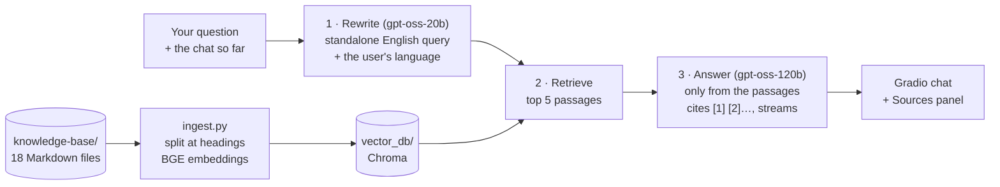

# 🍛 Crave Assist: RAG over a food delivery company's documents

[](https://github.com/C0derANANT/ai-engineering-projects/actions/workflows/food-rag-tests.yml)

Ask anything about **CraveCart**, a fictional Zomato-style food delivery company, and get answers taken **only from its 18 help, policy and HR documents**, with the exact passages shown. This is RAG (Retrieval-Augmented Generation): the app finds the relevant passages in a vector database, and the LLM answers from them instead of from memory. Built for the Incapp AI Engineer course, starting from the class `RAG_APP.ipynb`.

**Live demo: [crave-assist.onrender.com](https://crave-assist.onrender.com)** (free plan: the first visit after a quiet spell takes about a minute to wake up).


| What it does | How |
|---|---|
| Answers **only from the company's documents** | 18 Markdown documents, split at their headings and stored in a Chroma vector DB; the 5 closest passages go to the LLM |
| Shows **where every answer came from** | `[n]` markers in the answer, plus a Sources panel with the matching passages |
| Understands **follow-up questions** | "What if it was already picked up?" is rewritten with the chat history into one standalone search query |
| Speaks English, हिंदी and Hinglish | Searches in English, replies in the language and script the user typed in |
| Says **"I don't know"** instead of guessing | If the passages don't cover it, the answer says so and points to support |
| Runs on a free 512 MB server | BGE embeddings on ONNX (fastembed) instead of PyTorch; the vector DB is built into the Docker image |

## Class version vs Crave Assist

| | Class `RAG_APP.ipynb` | Crave Assist |
|---|---|---|
| Chunks | Fixed 1,000-character pieces | Split at the document's headings, with the heading path kept on each chunk |
| Embeddings | `all-MiniLM-L6-v2` (PyTorch) | `bge-small-en-v1.5` on ONNX, with BGE's search instruction on queries |
| What gets searched | The raw latest message | A standalone English query written from the message and the chat history |
| Answer | Appears all at once, no sources | Streams, cites `[1]` `[2]`…, Sources panel |
| Languages | English | English, Hindi, Hinglish |
| Tests | None | 47 tests, run by GitHub Actions on every push |
| Hosting | A temporary `gradio.live` link | A Docker image on Render |

## How it works



## Project layout

```
03-Food-Delivery-RAG/
├── app.py                  # Gradio app (chat + Sources panel)
├── ingest.py               # builds the vector DB (python ingest.py --help)
├── rag/
│   ├── config.py           # settings, .env handling, Render port
│   ├── knowledge_base.py   # loading, heading-aware chunking, embeddings, Chroma, auto-refresh
│   ├── assistant.py        # rewrite → retrieve → answer, citations, history, language, errors
│   └── ui.py               # examples, page text, Sources panel formatting
├── knowledge-base/         # 18 Markdown documents, one folder per doc_type
├── notebooks/
│   ├── 00_class_baseline_rag_db.ipynb  # the simple class pipeline, for comparison
│   ├── 01_build_vector_db.ipynb        # build the vector DB step by step (runs in Colab)
│   └── 02_chat_app.ipynb               # the whole RAG chat in a notebook (runs in Colab)
├── tests/                  # 47 tests, no internet or API key needed
├── Dockerfile              # the Render image (vector DB built at build time)
└── docs/                   # demo GIF and screenshot
```

## Run it locally

Needs Python 3.12 or newer. The first run downloads the embedding model (about 67 MB).

```bash
cd 03-Food-Delivery-RAG
python3 -m venv .venv && source .venv/bin/activate
pip install -r requirements.txt
cp .env.example .env          # then add GROQ_API_KEY
python app.py                 # builds the vector DB on first run, then opens http://localhost:7860
```

Get a free Groq key at [console.groq.com/keys](https://console.groq.com/keys). Without a key the app still runs: it shows the most relevant passages and says live answers are off. Adding the key to `.env` turns answers on without a restart.

### Useful commands

```bash
python ingest.py --stats                       # chunks per document
python ingest.py --force                       # rebuild the vector DB
python ingest.py --query "late night fee"      # see what the search returns
pytest                                         # run the tests
```

The vector DB rebuilds itself whenever a document, the chunk settings or the embedding model changes.

## Try these

- `Can I cancel my order after the restaurant starts cooking? Is there a fee?` then `Aur agar delivery partner ne order pick up kar liya ho toh?`: a Hinglish follow-up, answered from the fee schedule
- `मेरे ऑर्डर में एक आइटम नहीं आया, रिफंड कैसे मिलेगा?`: Hindi in, Hindi out, with the 3-hour reporting rule
- `Plus ka price kitna hai?`: ₹149 for 3 months or ₹449 for 12
- `What does error CC-PAY-302 mean?`: an exact error code found in the support documents
- `How many sick leaves do employees get, and do they carry forward?`: an HR question (10 days, up to 20 carried)
- `What's the capital of France?`: politely refused, since it isn't about CraveCart

## Edge cases handled

| Situation | What happens |
|---|---|
| Follow-up like "what if it was already cooking?" | Rewritten into a full question using the chat history |
| Hindi, Hinglish or mixed input | Searched in English; answered in the user's own script |
| A question about "my order" | Explains the policy that applies; it can't see real orders or accounts, and says so |
| The documents don't cover it | Says it doesn't have that information and points to in-app support |
| Off-topic questions | Politely refused |
| Empty or very long messages | A friendly message; nothing crashes |
| No API key | Still shows the most relevant passages |
| Wrong key, rate limit, timeout or network error | A clear message; a half-written answer is kept with a note |
| The question rewrite fails | Searches with the raw question instead |
| Changed knowledge-base documents | The vector DB rebuilds automatically on the next start |
| Loose or empty files in `knowledge-base/` | Skipped with a warning (the class notebook's loader would crash on a loose file) |

## Tests and continuous integration

```bash
pytest
```

The 47 tests use fake embeddings and a scripted fake LLM, so they run offline in about a second with no keys. They cover loading and chunking the documents, the vector DB refresh, query rewriting, citations, chat history, languages, every error path and the Sources panel. GitHub Actions runs them on every push that touches this folder ([`food-rag-tests.yml`](../.github/workflows/food-rag-tests.yml)).

## Notebooks (Google Colab)

Run them in order; each one works in Colab (it clones this repo) or locally.

- **`notebooks/00_class_baseline_rag_db.ipynb`** is the simple pipeline from class (load → split → `all-MiniLM-L6-v2` → Chroma → Groq), pointed at the CraveCart documents. It's the baseline the other two improve on.
- **`notebooks/01_build_vector_db.ipynb`** builds the upgraded vector DB step by step: heading-aware chunks, BGE embeddings, auto-refresh.
- **`notebooks/02_chat_app.ipynb`** walks through rewrite → retrieve → answer and launches the Gradio app with a public link. Add `GROQ_API_KEY` under Colab's 🔑 Secrets first.

## Deploy (Render)

The [live demo](https://crave-assist.onrender.com) runs on Render's free plan from the [`render.yaml`](../render.yaml) Blueprint at the repo root (service `crave-assist`, Docker, built from this folder's [`Dockerfile`](Dockerfile)).

- **Fits in 512 MB:** the BGE embeddings run on ONNX through fastembed instead of PyTorch, and the Docker build downloads the model and builds the vector DB, so the live app starts in seconds.
- **Only tested code goes live:** Render deploys a push only after the GitHub Actions tests pass (`autoDeployTrigger: checksPass`).
- **Keys stay out of the repo:** `GROQ_API_KEY` is set in the Render dashboard.
- **Free-plan limits:** the service sleeps after 15 idle minutes and takes about a minute to wake. It shares the workspace's 750 free hours a month with the other demos in this repo.

To run the same image locally: `docker build -t crave-assist . && docker run -p 7860:7860 --env-file .env crave-assist`.

## Configuration

| Variable | Required | Default |
|---|---|---|
| `GROQ_API_KEY` | Yes | none |
| `GROQ_MODEL` | No | `openai/gpt-oss-120b` (writes the answer) |
| `REWRITE_MODEL` | No | `openai/gpt-oss-20b` (writes the search query) |
| `TOP_K` | No | `5` passages per question |
| `EMBEDDING_MODEL` | No | `BAAI/bge-small-en-v1.5` |
| `KNOWLEDGE_BASE_DIR`, `VECTOR_DB_DIR` | No | `knowledge-base/`, `vector_db/` |

## Stack

LangChain · Chroma · BGE embeddings on ONNX (fastembed) · Groq (`gpt-oss-120b`, `gpt-oss-20b`) · Gradio 6 · pytest + GitHub Actions · Docker on Render

---

Built by **Anant Aggarwal** · B.Tech CSE (AI) · CraveCart is a fictional company for a learning project.
